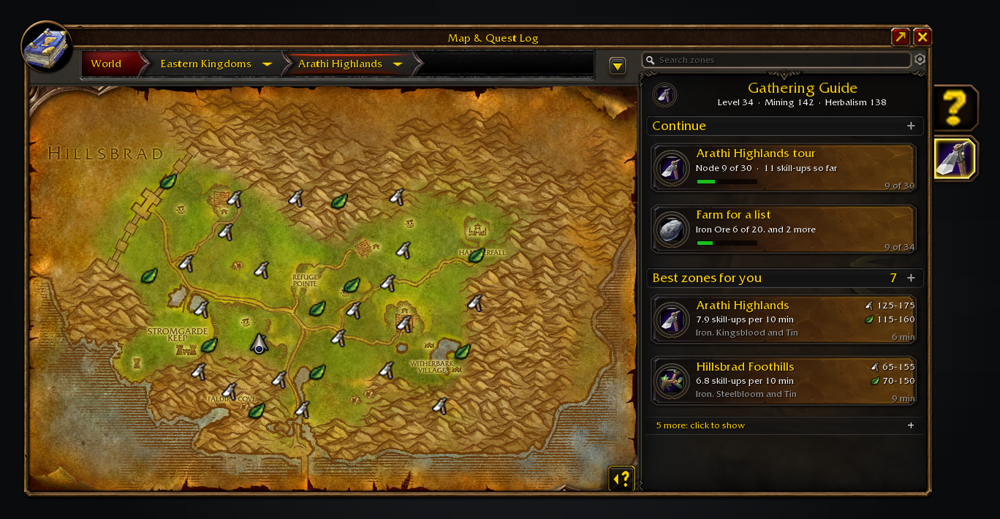
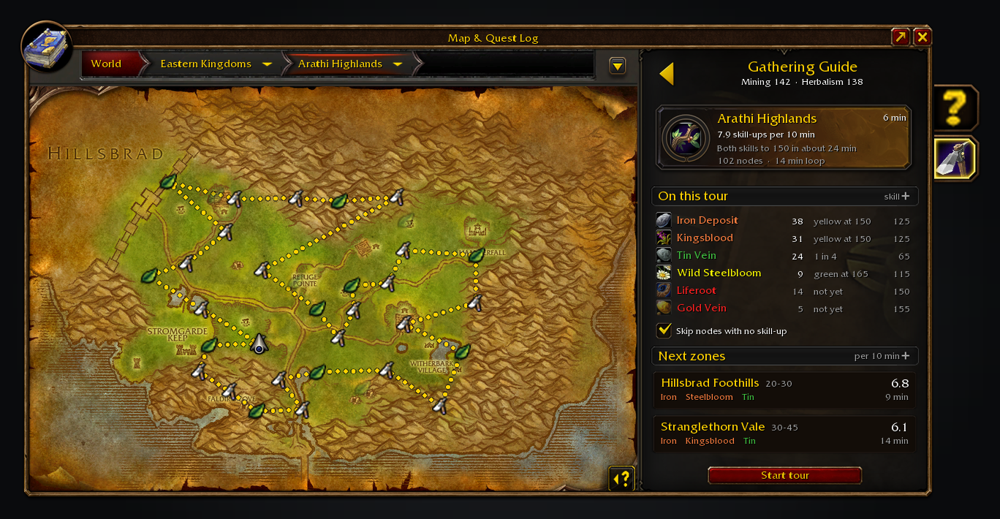
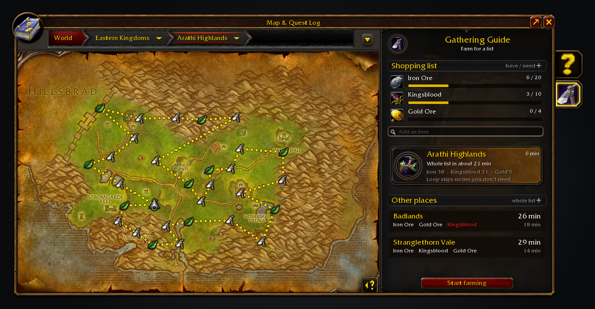

<h1 align="center">Gathering Guide Forever</h1>

<p align="center">
Plan a mining or herbalism skill-up tour in WoW: Forever: the best zones for your skill, a walking loop through every node, and a farming list.<br>
<a href="https://github.com/cjber/gathering-guide-forever/actions/workflows/ci.yml"></a>
<a href="https://github.com/cjber/gathering-guide-forever/releases/latest"></a>
<br><br><a href="https://github.com/sponsors/cjber"></a> <a href="https://ko-fi.com/cjber"></a>
</p>

Gathering Guide Forever adds a Gathering page to the world map's quest log. It reads the nodes in your GatherMate2 database, works out which zones will raise your mining or herbalism fastest at your current skill, and hands a walking loop through the nodes to [Shortest Path Forever](https://www.curseforge.com/wow/addons/shortest-path-forever), which guides you from node to node.

The images below are mocks of the planned interface, not captures from the game.

<p align="center"></p>

Each zone card shows the skill range it covers, the travel time and the skill-ups you can expect per ten minutes.

<p align="center"></p>

A zone lists its nodes by the chance each has to raise your skill, and the next zones to move on to as it rises.

<p align="center"></p>

Farm for a list instead: add herbs and ores with how many you need, and the page finds the best zone for the whole list.

## Install

Install it with the [CurseForge app](https://www.curseforge.com/wow/addons/gathering-guide-forever), or download the zip from [Releases](https://github.com/cjber/gathering-guide-forever/releases) and extract it into the WoW: Forever client's `Interface/AddOns/` folder so you end up with `AddOns/GatheringGuideForever/GatheringGuideForever.toc`.

It needs [GatherMate2](https://www.curseforge.com/wow/addons/gathermate2) for node locations and [Shortest Path Forever](https://www.curseforge.com/wow/addons/shortest-path-forever) to walk a tour. Without Shortest Path Forever you can still plan.

## Quickstart

1. Open the world map and pick the Gathering tab, or type `/gathering`.
2. Choose a zone from Best zones for you.
3. Press Start tour. The tour begins at the node nearest you and follows the loop.

## Features

- **Best zones for you.** Mining and Herbalism each list the zones that give the most skill-ups per ten minutes at your current skill, with the skill range, travel time and rate.
- **Zone view.** Every node in the zone is coloured by its chance to raise your skill. "Skip nodes with no skill-up" leaves out nodes that can no longer help, and Next zones shows where to go as your skill rises.
- **Gathering tours.** The loop starts at the node nearest you. A breadcrumb trail on the world map and a Gathering Tour section in the objective tracker follow your progress.
- **Farm for a list.** A shopping list with how many you carry and need, and the best zone for all of it.
- **Live tally and gold per hour.** The tracker counts what you loot on a tour, shows what a list item still needs with a progress bar and your gold per hour from Auctionator or the vendor price. It lasts as long as the tour.

| Command | What it does |
|---|---|
| `/gathering`, `/ggf` | Open the Gathering page on the world map |
| `/ggf report` | Open the bug report window |

Saved farming settings from Shortest Path Forever are read once and never changed.

## Known limitations

- Skill-up chances follow Classic's rule: a node gives a skill point for certain while your skill is under 25 above its requirement, then 75%, 25% and never from 100 above. WoW: Forever may differ.
- The rate assumes a walking pace of 7 yards a second and 5 seconds at each node. The loop is a close approximation of the shortest one, not the exact shortest.
- Nodes are whatever your GatherMate2 database holds.

## Credits

Built on [GatherMate2](https://www.curseforge.com/wow/addons/gathermate2) node data, the farming tour from [Shortest Path Forever](https://github.com/cjber/shortest-path-forever) and the node skill table from [SkillUp Forever](https://github.com/cjber/skillup-forever). See [THIRD_PARTY.md](THIRD_PARTY.md) for sources and licences.

<!-- forever-family:start -->

## The Forever addons

Each one works on its own, and they work together when you install more than one.

| Addon | What it does | Issues |
|---|---|---|
| [Shortest Path Forever](https://www.curseforge.com/wow/addons/shortest-path-forever) | Plans journeys on foot, by air, by sea and through portals, with directions in the tracker. | [Issues](https://github.com/cjber/shortest-path-forever/issues) |
| [Adventure Guide Forever](https://www.curseforge.com/wow/addons/adventure-guide-forever) | Suggests quests for your level and routes you from one to the next. | [Issues](https://github.com/cjber/adventure-guide-forever/issues) |
| [SkillUp Forever](https://www.curseforge.com/wow/addons/skillup-forever) | Shows skill-up chances, recipe costs and levelling routes in the Professions window. | [Issues](https://github.com/cjber/skillup-forever/issues) |
| [Legacy Forever](https://www.curseforge.com/wow/addons/legacy-forever) | Shows your unfinished Legacy challenges on the world map and tracks the ones you choose. | [Issues](https://github.com/cjber/legacy-forever/issues) |
| [Tweaks Forever](https://www.curseforge.com/wow/addons/tweaks-forever) | Adds quest automation, rare alerts and merchant options to the game's settings. | [Issues](https://github.com/cjber/tweaks-forever/issues) |
| [Field Guide Forever](https://www.curseforge.com/wow/addons/field-guide-forever) | Keeps a cosmetic journal of the creatures you kill, zone by zone. | [Issues](https://github.com/cjber/field-guide-forever/issues) |
| [Commissions Forever](https://www.curseforge.com/wow/addons/commissions-forever) | Lists your commission turn-ins, the materials in your bags and the next NPC to visit. | [Issues](https://github.com/cjber/commissions-forever/issues) |
| [Macro Assist Forever](https://www.curseforge.com/wow/addons/macro-assist-forever) | Adds a macro window with every macro in one list, a mono editor with live checks, and history. | [Issues](https://github.com/cjber/macro-assist-forever/issues) |

Bug reports, feature requests and pull requests are welcome on each addon's GitHub. Everyone whose report or idea ships is thanked by name on the Thanks page in game, in the store page and in the changelog, unless they ask not to be.

For help, ideas and each day's release notes, join [cjber's Workshop on Discord](https://discord.gg/FpHugGxRJY).

<!-- forever-family:end -->

<!-- forever-credits:start -->

Thanks to everyone who reports a bug or asks for a feature.

<!-- forever-credits:end -->

## Development

```sh
stylua --check . && luacheck .
python3 -m tools.forever_tools.specs      # the specs (set FOREVER_CORE to a forever-core checkout)
python3 tools/repo_rules.py
```

[AGENTS.md](AGENTS.md) lists the full gate. The mock images in `docs/mockups/` are drawn by the scripts beside them.

**Releasing:** move the `[Unreleased]` notes in `CHANGELOG.md` under `## [X.Y.Z] - YYYY-MM-DD`, then `git tag -s vX.Y.Z && git push --tags`.

See [CONTRIBUTING](https://github.com/cjber/.github/blob/main/CONTRIBUTING.md) and [SECURITY](https://github.com/cjber/.github/blob/main/SECURITY.md).
