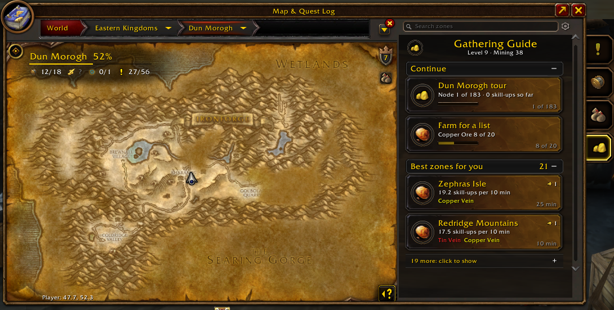
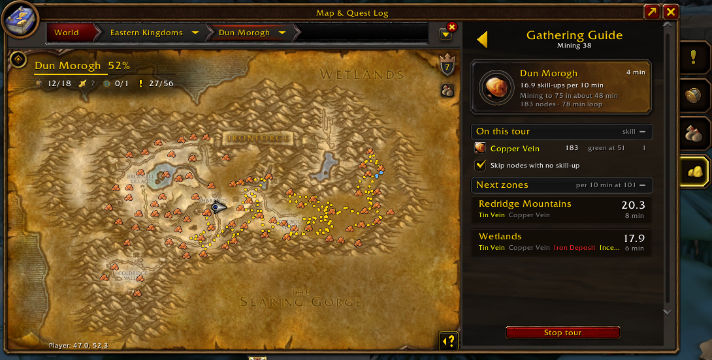
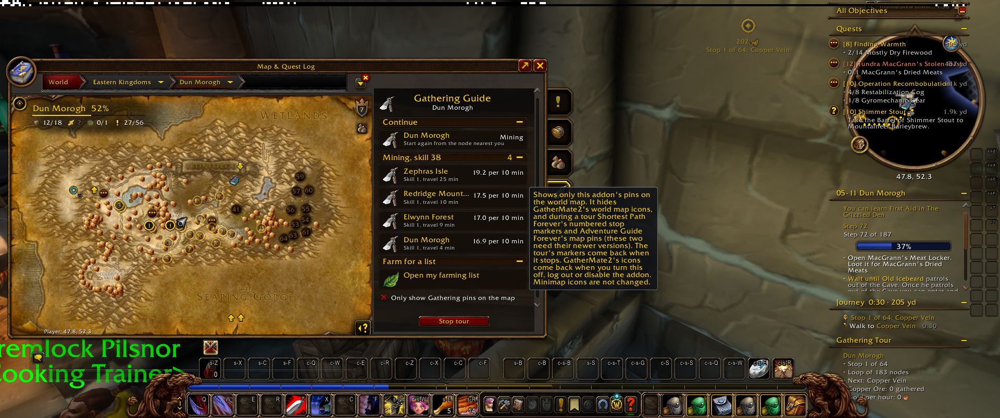
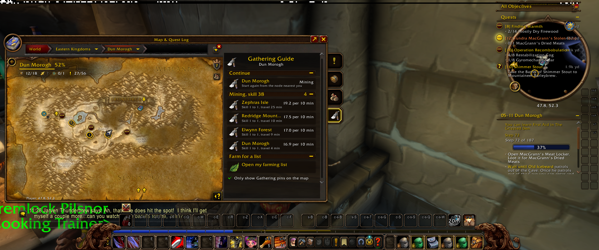
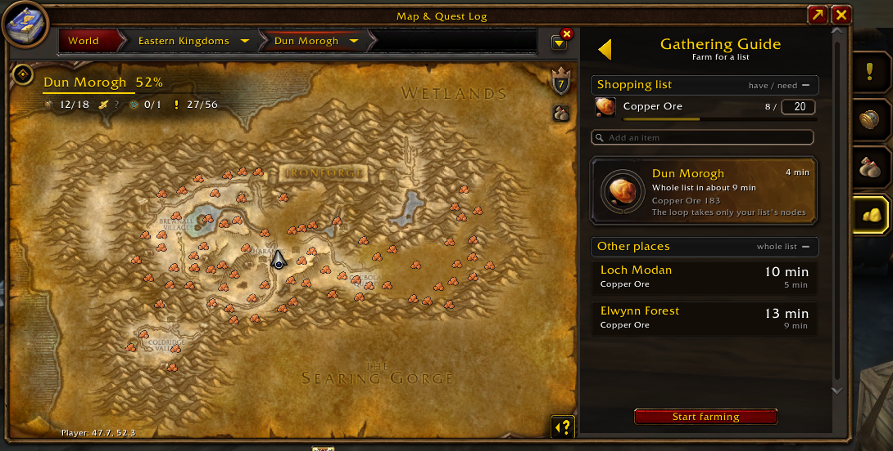

<h1 align="center">Gathering Guide Forever</h1>

<p align="center">
Plan a mining and herbalism skill-up tour in WoW: Forever: the best zones for your skills, one walking loop through their nodes, and a farming list.<br>
<a href="https://github.com/cjber/gathering-guide-forever/actions/workflows/ci.yml"></a>
<a href="https://github.com/cjber/gathering-guide-forever/releases/latest"></a>
<br><br><a href="https://github.com/sponsors/cjber"></a> <a href="https://ko-fi.com/cjber"></a>
</p>

Gathering Guide Forever adds a Gathering page to the world map's quest log. It reads the nodes in your GatherMate2 database, works out which zones will raise your skill fastest, and hands a walking loop through the nodes to [Shortest Path Forever](https://www.curseforge.com/wow/addons/shortest-path-forever), which guides you from node to node. With Mining and Herbalism both learned, one loop takes in veins and herbs together.

All images are real captures from the game client.

<p align="center"></p>

Each zone card shows the skill range of its nodes, the travel time and the skill-ups you can expect per ten minutes.

<p align="center"></p>

A zone shows how long it takes to reach your trained maximum, the chance each node has to raise your skill and the next zones to move on to.

<p align="center"></p>

A tour starts at the node nearest you. Shortest Path Forever draws the way to the next stop.

<p align="center"></p>

Only the nodes still to visit get a pin, showing the herb or ore, and the next one is clearer. Nearby nodes share one pin until you zoom in.

<p align="center"></p>

The objective tracker shows the next node and its distance, your place in the loop, each skill and your skill-ups, what you gathered, your gold per hour and the zone to move on to.

<p align="center"></p>

With Only show Gathering pins on the map turned off, GatherMate2's icons come back.

<p align="center"></p>

Turned on again, the map shows only this addon's pins.

<p align="center"></p>

Stopping the tour clears the pins and the tracker section.

<p align="center"></p>

Farm for a list instead: add herbs and ores, type how many you need of each, and the page finds the zone that gets you what is still missing and gatherable at your skill soonest, the trip there included. Items above your skill show the skill they need.

## Install

Download the zip from [Releases](https://github.com/cjber/gathering-guide-forever/releases) and extract it into the WoW: Forever client's `Interface/AddOns/` folder (`_forever_` on the live client), so you end up with `AddOns/GatheringGuideForever/GatheringGuideForever.toc`. The zip includes ForeverCore, so there is nothing else to install.

It needs [GatherMate2](https://www.curseforge.com/wow/addons/gathermate2) for node locations and [Shortest Path Forever](https://www.curseforge.com/wow/addons/shortest-path-forever) to walk a tour. Without Shortest Path Forever you can still plan.

## Quickstart

1. Open the world map and pick the Gathering tab, or type `/gathering`.
2. Choose a zone from Best zones for you, or type its name in Search zones.
3. Press Start tour. The tour begins at the node nearest you and follows the loop.

## Features

- **Best zones for you.** One ranking for your gathering professions: the zones whose loop gives the most skill-ups per ten minutes at your skill, with each skill range, travel time and rate. The top two show and a click brings up the rest. Search zones finds a zone by name.
- **Zone view.** Picking a zone turns the world map to it and pins its loop. The page shows the time to your trained maximum, every node coloured by its chance to raise its profession's skill, and Next zones for when your skill rises, with level ranges where the game gives them. "Skip nodes with no skill-up" leaves out nodes that can no longer help.
- **Gathering tours.** The loop starts at the node nearest you. The nodes on the loop get small pins on the world map, each herb and ore in its own picture (nearby nodes share one until you zoom in, a visited node is dropped, the next one clearer) and a Gathering Tour section in the objective tracker follows your progress. The way between the stops is Shortest Path Forever's own journey line, drawn for the batch it is walking (up to 64 stops, then the next batch); the loop itself is a straight-line hop list, and the walking route between stops is Shortest Path Forever's.
- **A calm world map.** "Only show Gathering pins on the map" (on by default, in the settings menu at the top of the Gathering page) hides GatherMate2's world map icons while the addon is loaded, so the map shows only this addon's small pins: the loop's nodes on a tour, or the zone you are viewing in the panel. While the Gathering page is up or a tour runs it also hides the game's quest markers and sets aside the map pins of Shortest Path Forever, Adventure Guide Forever and Legacy Forever, and a tour's route leaves out numbered stop markers (the route line stays). These three addons need versions that allow it; older ones keep showing their pins. The markers come back when you leave the page and no tour is running; GatherMate2's icons come back when you turn the option off, log out or disable the addon. Minimap icons are not changed.
- **Farm for a list.** A shopping list with how many you carry and need, the skill each item above yours needs, and the best zone for what you can gather now.
- **Live tally and gold per hour.** The tracker counts what you loot on a tour, shows what a list item still needs with a progress bar and your gold per hour from Auctionator or the vendor price. It lasts as long as the tour.

| Command | What it does |
|---|---|
| `/gathering`, `/ggf` | Open the Gathering page on the world map |
| `/ggf report` | Open the bug report window |

Saved farming settings from Shortest Path Forever are read once and never changed.

## Known limitations

- Skill-up chances follow Classic's rule: a node gives a skill point for certain while your skill is under 25 above its requirement, then 75%, 25% and never from 100 above. WoW: Forever may differ.
- The rate assumes a walking pace of 7 yards a second and 5 seconds at each node. The loop is a close approximation of the shortest one, not the exact shortest.
- A lap takes at least ten minutes, the assumed time a node needs to respawn: no source gives Forever's real time. A zone's rate also counts the trip there from where you stand when it is planned.
- The time to a skill assumes the same loop every lap. It is left off when the loop's nodes cannot take you that far.
- Nodes are whatever your GatherMate2 database holds.
- Node and item names are in English in every client language.
- Heavy Thorium Veins, Demonsage and Marefoil are left out: the skill they need is not known yet.

## Credits

Built on [GatherMate2](https://www.curseforge.com/wow/addons/gathermate2) node data, the farming tour from [Shortest Path Forever](https://github.com/cjber/shortest-path-forever) and the node skill table from [SkillUp Forever](https://github.com/cjber/skillup-forever). See [THIRD_PARTY.md](THIRD_PARTY.md) for sources and licences.

<!-- forever-family:start -->

## The Forever addons

Each one works on its own, and they work together when you install more than one.

| Addon | What it does | Issues |
|---|---|---|
| [Shortest Path Forever](https://www.curseforge.com/wow/addons/shortest-path-forever) | Plans journeys on foot, by air, by sea and through portals, with directions in the tracker. | [Issues](https://github.com/cjber/shortest-path-forever/issues) |
| [Adventure Guide Forever](https://www.curseforge.com/wow/addons/adventure-guide-forever) | Suggests quests for your level and routes you from one to the next. | [Issues](https://github.com/cjber/adventure-guide-forever/issues) |
| [SkillUp Forever](https://www.curseforge.com/wow/addons/skillup-forever) | Shows skill-up chances, recipe costs and levelling routes in the Professions window. | [Issues](https://github.com/cjber/skillup-forever/issues) |
| [Legacy Forever](https://www.curseforge.com/wow/addons/legacy-forever) | Shows your unfinished Legacy challenges on the world map and tracks the ones you choose. | [Issues](https://github.com/cjber/legacy-forever/issues) |
| [Tweaks Forever](https://www.curseforge.com/wow/addons/tweaks-forever) | Adds quest automation, rare alerts and merchant options to the game's settings. | [Issues](https://github.com/cjber/tweaks-forever/issues) |
| [Field Guide Forever](https://www.curseforge.com/wow/addons/field-guide-forever) | Keeps a cosmetic journal of the creatures you kill, zone by zone. | [Issues](https://github.com/cjber/field-guide-forever/issues) |
| [Commissions Forever](https://www.curseforge.com/wow/addons/commissions-forever) | Lists your commission turn-ins, the materials in your bags and the next NPC to visit. | [Issues](https://github.com/cjber/commissions-forever/issues) |
| [Macro Assist Forever](https://www.curseforge.com/wow/addons/macro-assist-forever) | Adds a macro window with every macro in one list, a mono editor with live checks, and history. | [Issues](https://github.com/cjber/macro-assist-forever/issues) |

Bug reports, feature requests and pull requests are welcome on each addon's GitHub. Everyone whose report or idea ships is thanked by name on the Thanks page in game, in the store page and in the changelog, unless they ask not to be.

For help, ideas and each day's release notes, join [cjber's Workshop on Discord](https://discord.gg/FpHugGxRJY).

<!-- forever-family:end -->

<!-- forever-credits:start -->

Thanks to everyone who reports a bug or asks for a feature.

<!-- forever-credits:end -->

## Development

```sh
stylua --check . && luacheck .
python3 -m tools.forever_tools.specs      # the specs (set FOREVER_CORE to a forever-core checkout)
python3 tools/repo_rules.py
```

[AGENTS.md](AGENTS.md) lists the full gate.

**Releasing:** move the `[Unreleased]` notes in `CHANGELOG.md` under `## [X.Y.Z] - YYYY-MM-DD`, then `git tag -s vX.Y.Z && git push --tags`.

See [CONTRIBUTING](https://github.com/cjber/.github/blob/main/CONTRIBUTING.md) and [SECURITY](https://github.com/cjber/.github/blob/main/SECURITY.md).
