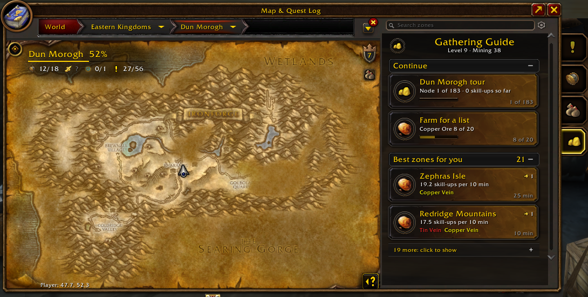
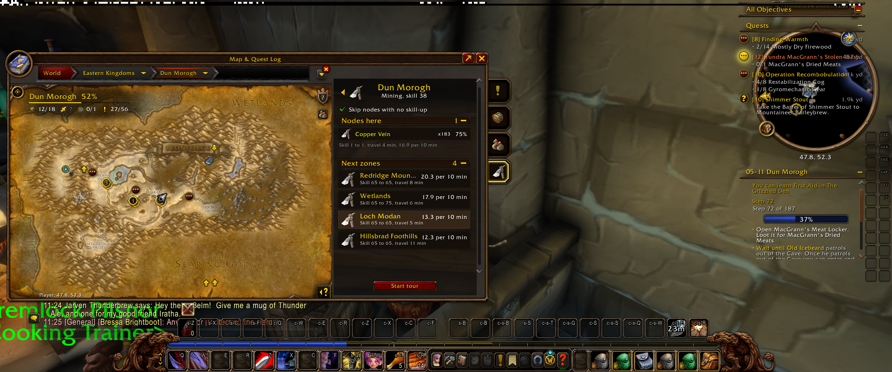
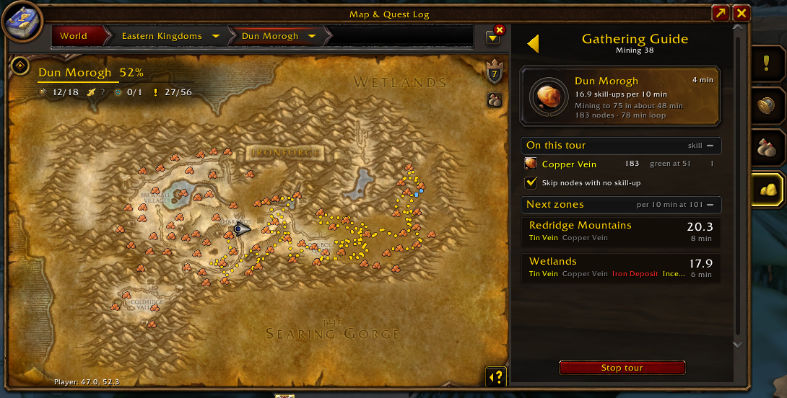
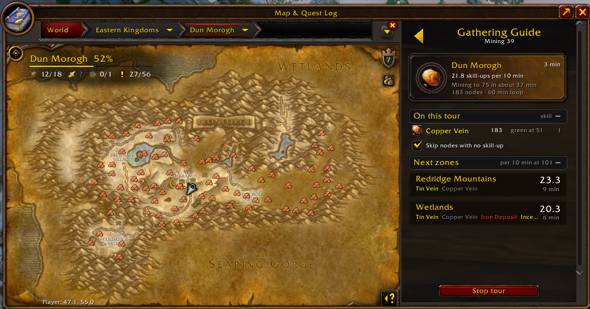
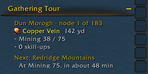
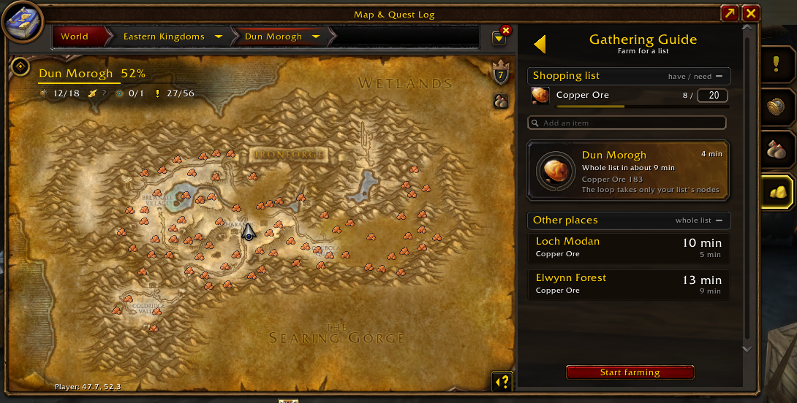

Gathering Guide Forever plans a mining and herbalism skill-up tour in WoW: Forever. It reads the nodes in your GatherMate2 database, finds the zones that raise your skill fastest, and has Shortest Path Forever walk you through a loop of them. With both professions, one loop takes in veins and herbs together.

It needs [GatherMate2](https://www.curseforge.com/wow/addons/gathermate2) for node locations and [Shortest Path Forever](https://www.curseforge.com/wow/addons/shortest-path-forever) to walk a tour.

GatherMate2 starts with no node locations and records each node you gather. To fill it at once, install [GatherMate2_Data](https://www.curseforge.com/wow/addons/gathermate2_data), type `/gathermate`, open Import, tick Herbalism and Mining and click Import GatherMate2Data.

Free, with nothing locked behind it. If it saves you time, you can [sponsor me on GitHub](https://github.com/sponsors/cjber), which takes no fees, or [buy me a coffee on Ko-fi](https://ko-fi.com/cjber). For help and each day's release notes, [join me on Discord](https://discord.gg/FpHugGxRJY).

  

The Gathering page ranks the best zones for your skills, with their skill ranges, travel time and rate.

A zone shows the time to your trained maximum, the chance each node has to raise your skill and the next zones to move on to.

A tour starts at the node nearest you, with Shortest Path Forever drawing the way.

Only the nodes still to visit get a pin on the world map, showing the herb or ore. Nearby nodes share one pin until you zoom in.

The objective tracker shows the next node and its distance, your place in the loop, each skill against the next node colour change, your skill-ups, what you gathered, your gold per hour and the zone to move on to.

Farm for a list: how many of each herb or ore you carry, and the best zone for what you can gather now.

These images are captures from the game client.

## Features

- **Best zones for you.** One ranking for your gathering professions by skill-ups per ten minutes, with a click for more zones and a zone search by name.
- **Zone view.** Picking a zone turns the world map to it and pins its loop. The page shows the time to your trained maximum, every node coloured by its chance to raise your skill, and Next zones for when it rises.
- **Gathering tours.** The loop starts at the node nearest you, with Shortest Path Forever's journey line on the world map and a Gathering Tour section in the objective tracker.
- **Farm for a list.** A shopping list with how many you carry and need, the skill each item above yours needs, and the best zone for what you can gather now.
- **A calm world map.** While the Gathering page is up or a tour runs, other map markers are cleared so the route and the node pins stand out. Other addons need versions that allow it, and one setting turns this off.

## Known limitations

Skill-up chances follow Classic's rule: certain while your skill is under 25 above a node's requirement, then 75%, 25% and never from 100 above. WoW: Forever may differ.

Node and item names are in English in every client language. Marefoil is left out: the skill it needs is not known yet.

A lap takes at least ten minutes, the assumed time a node needs to respawn: no source gives Forever's real time. A zone's rate also counts the trip there from where you stand when it is planned. The time to a skill is left off when a loop's nodes cannot take you that far.

## Usage

Open the world map and pick the Gathering tab, or type `/gathering` or `/ggf`.

For a bug report, paste `/ggf report`.

<!-- forever-family:start -->

## The Forever addons

Each one works on its own, and they work together when you install more than one.

| Addon | What it does | Issues |
|---|---|---|
| [Shortest Path Forever](https://www.curseforge.com/wow/addons/shortest-path-forever) | Plans journeys on foot, by air, by sea and through portals, with directions in the tracker. | [Issues](https://github.com/cjber/shortest-path-forever/issues) |
| [Adventure Guide Forever](https://www.curseforge.com/wow/addons/adventure-guide-forever) | Suggests quests for your level and routes you from one to the next. | [Issues](https://github.com/cjber/adventure-guide-forever/issues) |
| [SkillUp Forever](https://www.curseforge.com/wow/addons/skillup-forever) | Shows skill-up chances, recipe costs and levelling routes in the Professions window. | [Issues](https://github.com/cjber/skillup-forever/issues) |
| [Legacy Forever](https://www.curseforge.com/wow/addons/legacy-forever) | Shows your unfinished Legacy challenges on the world map and tracks the ones you choose. | [Issues](https://github.com/cjber/legacy-forever/issues) |
| [Tweaks Forever](https://www.curseforge.com/wow/addons/tweaks-forever) | Adds quest automation, rare alerts and merchant options to the game's settings. | [Issues](https://github.com/cjber/tweaks-forever/issues) |
| [Field Guide Forever](https://www.curseforge.com/wow/addons/field-guide-forever) | Keeps a cosmetic journal of the creatures you kill, zone by zone. | [Issues](https://github.com/cjber/field-guide-forever/issues) |
| [Commissions Forever](https://www.curseforge.com/wow/addons/commissions-forever) | Lists your commission turn-ins, the materials in your bags and the next NPC to visit. | [Issues](https://github.com/cjber/commissions-forever/issues) |
| [Macro Assist Forever](https://www.curseforge.com/wow/addons/macro-assist-forever) | Adds a macro window with every macro in one list, a mono editor with live checks, and history. | [Issues](https://github.com/cjber/macro-assist-forever/issues) |

Bug reports, feature requests and pull requests are welcome on each addon's GitHub. Everyone whose report or idea ships is thanked by name on the Thanks page in game, in the store page and in the changelog, unless they ask not to be.

For help, ideas and each day's release notes, join [cjber's Workshop on Discord](https://discord.gg/FpHugGxRJY).

<!-- forever-family:end -->

Source code and issues: [github.com/cjber/gathering-guide-forever](https://github.com/cjber/gathering-guide-forever). Licence: GPL-3.0-or-later.

Built with AI assistance.
